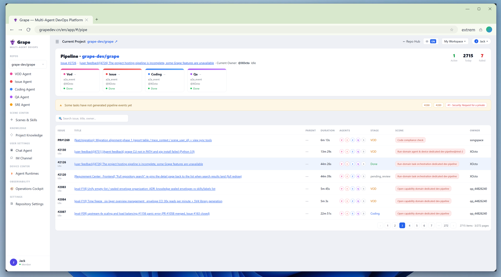
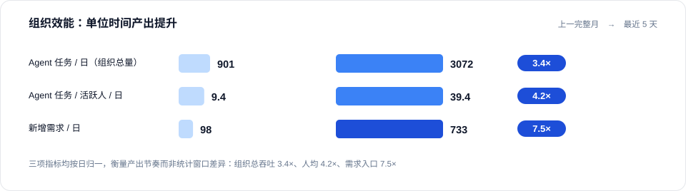
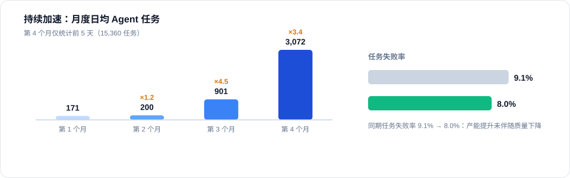
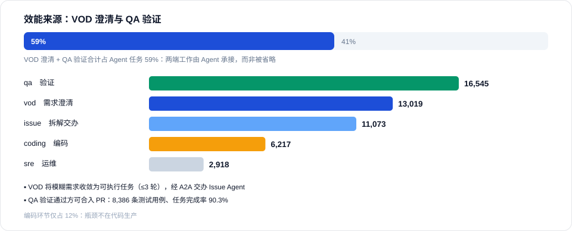

<div align="center">

  <h1><a href="https://www.grapedev.cn/" target="_blank" rel="noopener noreferrer"><picture><source media="(prefers-color-scheme: dark)" srcset="assets/grape-wordmark-dark.png"></picture></a></h1>

  <p>
    <strong>AI Native DevOps —— 将任意 Git 项目一键变为 AI 自主驱动的开发工作流</strong>
    <br>
    人只管需求与 Review，其余交给 Agent
  </p>
  <p>
    <a href="README.md">English</a> / 中文
  </p>
  <p>
    <a href="https://www.grapedev.cn/">▶ 立即体验</a> ·
    <a href="#五快速开始">快速开始</a> ·
    <a href="https://github.com/grape-dev/grape/issues">Issues</a> ·
    <a href="https://github.com/grape-dev/grape/%62lob/main/CONTRIBUTING.md">参与贡献</a>
  </p>
  <p>
    <a href="https://github.com/grape-dev/grape/%62lob/main/LICENSE"></a>
    <a href="https://github.com/grape-dev/grape/tags"></a>
    <a href="https://github.com/grape-dev/grape/issues"></a>
    <a href="https://github.com/grape-dev/grape/commits/main"></a>
    <a href="https://github.com/grape-dev/grape/graphs/contributors"></a>
  </p>

  <p>
    <a href="https://www.grapedev.cn/community.html?cat=join" title="加入社区群">&nbsp;飞书</a> ·
    <a href="https://www.grapedev.cn/community.html?cat=join" title="加入社区群">&nbsp;微信</a>
  </p>
</div>

---

## 一、Grape 是什么

Grape 把任意 Git 项目变成一支 AI 自主开发团队：需求、实现、审查、部署由多个 Agent 在同一条链上接力完成，人只写需求和做 Review。

**一句话：把你的 Git 项目变成 AI 驱动的自主开发团队。**

<p align="center">
  
</p>

> **三条设计原则**
>
> - **仓是事实来源** —— 需求、决策、评审证据、交付记录都落在仓上，人员变动也不断档
> - **AI 是流程参与者** —— Agent 有角色、有上下文、有产物，彼此经 A2A 交接，人在关键节点放行
> - **经验是资产** —— 每跑一次任务，经验、决策与问答即沉淀，并被后续任务按相关性召回

## 二、Grape 能做什么

| 能力 | 具体结果 |
| --- | --- |
| **五段 Agent 流水线** | VOD 收集声音建单 → Issue 分类指派 → Coding 编码提 PR → QA 审查与安全扫描 → SRE 构建部署运维；Chat Agent 随时问答。事件进来即自动贯穿全流程。 |
| **一键托管任意 Git 项目** | 选模板或喂现有仓库 → 自动套用「Agent × Skill」场景 → 异步首次引导（分析项目、建体验部署与探索 Issue）→ 此后每个 Issue / PR 自动处理。 |
| **Skills 技能库** | 15+ 官方技能覆盖全流程（声音收集、Issue 管理、代码实现、PR 审查、构建部署运维、通知、托管引导），支持官方 / 仓库级 / 个人级三态自定义。 |
| **多租户与可审计** | GitHub / GitCode OAuth 动态建号、登录白名单、凭据按用户隔离；每次 Agent 执行留痕（日志 / 耗时 / 结论），Pipeline 可追踪。 |
| **引擎可插拔** | opencode / codearts 等多后端切换，按 online-healthy-installed 选型。 |

## 三、解决的问题

传统 DevOps 中，从需求到发布的大量工作依赖人工：Issue 要手动分诊打标签、代码要开发自己写、PR 要人肉 Review、构建部署要手动触发。项目越多，人力成本越高。

Grape 的目标是将这些环节**全部 AI 化**，让开发者从执行者变为决策者——只需定义方向、Review 结果。

| 环节 | 传统工作流 | Grape AI Native 工作流 |
|------|-----------|----------------------|
| Issue 处理 | 人工分诊、标签、指派 | VOD / Issue Agent 自动分类、分派 |
| 代码实现 | 开发者手动编码 | Coding Agent 自动实现 + 提交 PR |
| 代码审查 | 人工 Review | QA Agent 自动审查 + 安全扫描 |
| 构建部署 | 手动 / CI 触发 | SRE Agent 自动构建、部署、运维 |
| 需求收集 | 人工汇总反馈 | VOD Agent 收集开发者声音、聚类提炼 |

## 四、提效实测

### 1. 组织效能 —— 单位时间产出提升

组织日均 Agent 任务由 901 增至 3,072（3.4×）；人均日均 9.4 → 39.4（4.2×）；需求入口 98 → 733 条/日（7.5×）。三项指标均按日归一，反映产出节奏变化，而非统计窗口差异。

<p align="center">
  
</p>

### 2. 持续加速 —— 产能与质量同步

月度日均 Agent 任务 171 → 200 → 901 → 3,072，最近一个统计周期环比提升 3.4×；同期任务失败率由 9.1% 降至 8.0%，产能提升未伴随质量下降。

<p align="center">
  
</p>

### 3. 效能来源 —— VOD 澄清与 QA 验证

Agent 任务的 59% 集中于流水线两端：VOD 将模糊需求收敛为可执行任务（≤3 轮）后经 A2A 交办；QA 验证通过方可合入 PR（8,386 条测试用例，任务完成率 90.3%）。编码环节仅占 12%，表明瓶颈不在代码生产，而在于两端工作是否交由 Agent 承接。

<p align="center">
  
</p>

## 五、快速开始

两种装法，任选其一 —— 交给 Agent，还是自己动手。

### ① 让 Agent 装（推荐）

把下面这段话发给你的 AI Agent，由它完成安装与启动：

**GitHub**

```text
按 https://github.com/grape-dev/grape/blob/main/SETUP.AGENT.md 里的步骤为我安装 Grape 平台并启动
```

**GitCode**

```text
按 https://gitcode.com/grape-dev/grape/blob/main/SETUP.AGENT.md 里的步骤为我安装 Grape 平台并启动
```

执行引擎与模型配置、托管首个仓库、环境自检、上线部署等其余事项，见 **[SETUP.AGENT.md](SETUP.AGENT.md)**。

前置依赖：Python ≥ 3.10（脚本会自动创建 `venv`）；国内网络默认走阿里云 PyPI 镜像（`mirrors.aliyun.com`）。完整步骤见 [SETUP.HUMAN.zh.md](SETUP.HUMAN.zh.md)。

首次上线？按自检清单逐项过一遍：[docs/0-to-1-checklist.md](docs/0-to-1-checklist.md)。

<details>
<summary><strong>② 人工安装（一条命令）</strong></summary>

**GitHub**

```bash
git clone https://github.com/grape-dev/grape.git && python3 grape/quickstart.py
```

**GitCode**

```bash
git clone https://gitcode.com/grape-dev/grape.git && python3 grape/quickstart.py
```

**Windows PowerShell**（5.1 不支持 `&&`，用 `;` 代替，仓库地址换成 GitHub 的亦可）：

```powershell
git clone https://github.com/grape-dev/grape.git ; python grape/quickstart.py
git clone https://gitcode.com/grape-dev/grape.git ; python grape/quickstart.py
```

首次登录、平台对外配置、上线部署等其余事项，见 **[SETUP.HUMAN.zh.md](SETUP.HUMAN.zh.md)**。

</details>

### 装完必做两步（自建部署）

| 步骤 | 不做的后果 | 怎么做 |
| --- | --- | --- |
| **配置 OAuth 应用凭据** | GitCode / GitHub 登录返回 400（`not_configured`），登录按钮灰 | `configs/oauth-providers.json` 填两个 provider 的 `client_id` / `client_secret`，回调须为 `https://<域名>/api/auth/callback/{gitcode,github}` |
| **配置对外可访问基址** | 回退 `localhost:3000`，OAuth 回调无法回访，登录与托管不可用 | `configs/server-config.json` 的 `server_base_url` 与 `webhook_url` 改成对外地址 |

## 社区与贡献

- **官网**：[grapedev.cn](https://www.grapedev.cn/)
- **场景与案例**：[社区与场景实践](https://www.grapedev.cn/community.html)
- **问题反馈**：[Issues](https://github.com/grape-dev/grape/issues)
- **交流**：<a href="https://www.grapedev.cn/community.html?cat=join" title="加入社区群">&nbsp;飞书</a> · <a href="https://www.grapedev.cn/community.html?cat=join" title="加入社区群">&nbsp;微信</a>
- **贡献**：修 bug、加需求、写 Skill 都欢迎 —— 见 [CONTRIBUTING.md](https://github.com/grape-dev/grape/%62lob/main/CONTRIBUTING.md)

## 安全与隐私

漏洞上报与 Agent 执行安全模型见 [SECURITY.md](https://github.com/grape-dev/grape/%62lob/main/SECURITY.md)。

## 许可证

MIT。
