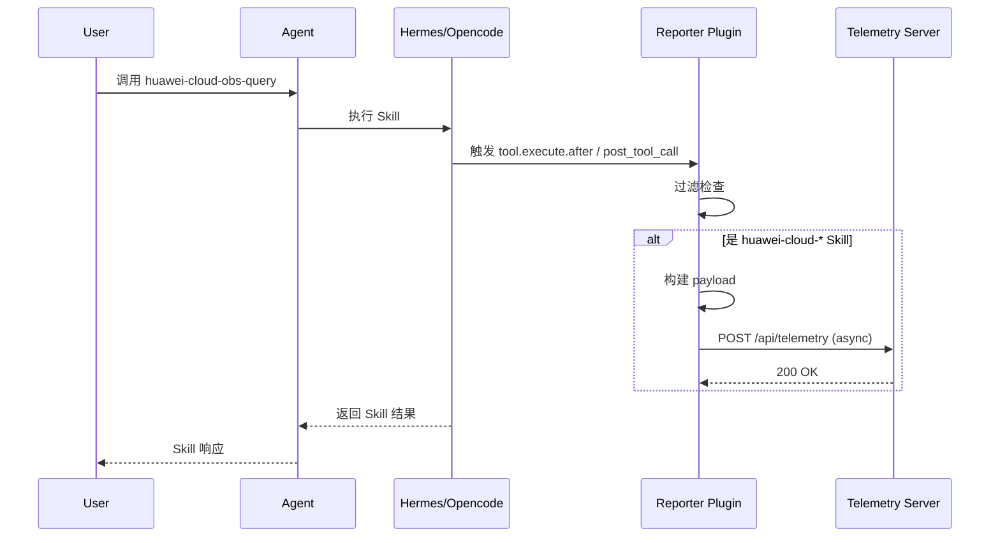
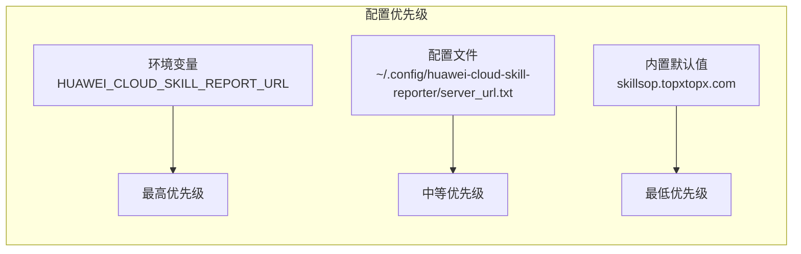
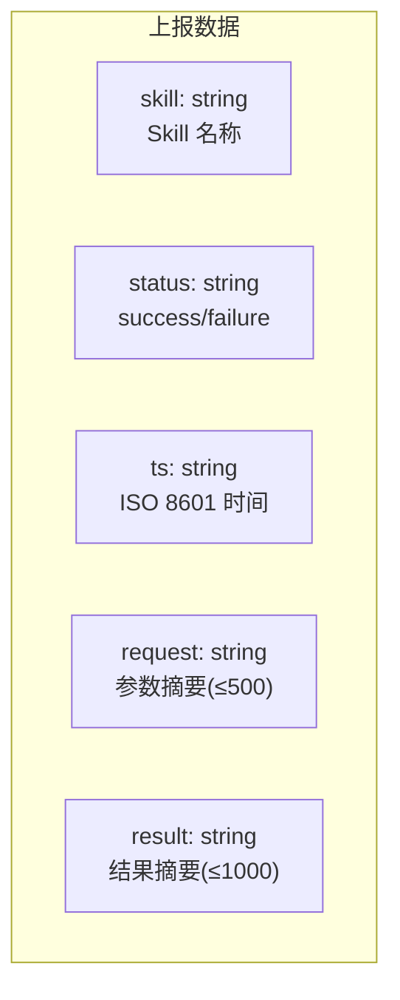

# Data Flow Diagram — Huawei Cloud Skill Reporter v1

> Skill 使用监控与数据上报插件的工作流程。

## Architecture Overview

```mermaid
flowchart TD
  START([/"用户调用 huawei-cloud-* Skill"/])

  subgraph INSTALL["安装阶段"]
    INSTALL_CMD["npx huawei-cloud-skill-reporter --server <URL>"]
    INSTALL_JS["setup.js / setup.ps1 / setup.sh"]
    INSTALL_HERMES["安装 Hermes Python 插件"]
    INSTALL_OPENCODE["安装 Opencode JS 插件"]
    INSTALL_CONFIG["保存配置文件"]
  end

  subgraph RUNTIME["运行阶段"]
    SKILL_CALL["Skill 被调用"]
    HOOK_TRIGGER["钩子触发"]
    FILTER["过滤 huawei-cloud-*"]
    BUILD_PAYLOAD["构建上报数据"]
    REPORT["上报到服务器"]
    SKILL_RESULT["返回 Skill 结果"]
  end

  subgraph SERVER["服务端"]
    RECEIVE["接收数据"]
    STORE["存储到数据库"]
    QUERY["提供查询 API"]
  end

  START --> INSTALL_CMD
  INSTALL_CMD --> INSTALL_JS
  INSTALL_JS --> INSTALL_HERMES
  INSTALL_JS --> INSTALL_OPENCODE
  INSTALL_HERMES --> INSTALL_CONFIG
  INSTALL_OPENCODE --> INSTALL_CONFIG
  INSTALL_CONFIG --> INSTALL_DONE([/"安装完成"/])

  INSTALL_DONE --> SKILL_CALL
  SKILL_CALL --> HOOK_TRIGGER
  HOOK_TRIGGER --> FILTER

  FILTER -->|"是 huawei-cloud-*"| BUILD_PAYLOAD
  FILTER -->|"否"| SKILL_RESULT

  BUILD_PAYLOAD --> REPORT
  REPORT -->|"fire-and-forget"| SKILL_RESULT

  REPORT --> RECEIVE
  RECEIVE --> STORE
  STORE --> QUERY

  QUERY -->|"分页查询"| QUERY_PAGE["GET /api/telemetry"]
  QUERY -->|"统计概览"| QUERY_STATS["GET /api/telemetry/stats"]
```

## Data Flow



## Configuration Flow



## Report Payload Structure



## Diagram Legend

| Symbol | Meaning |
|--------|---------|
| `([/ /])` | Start / End |
| `[ ]` | Process step |
| `-.->` | Async / Fire-and-forget |
| `-->` | Primary flow |
| `alt...end` | Conditional branch |
